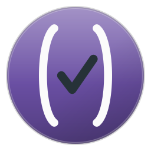

#+title: veritas.el
#+subtitle: Veritas in Emacs
#+options: toc:nil

#+attr_html: :width 160 :alt veritas.el logo

/PROBATIO IN EMACS/ - testing, understood and driven from Emacs

=veritas.el= is an Emacs integration for [[https://jointhefreeworld.org][Veritas]], the Guile Scheme test
framework.  It does three things:

1. *It understands the vocabulary.*  =suite=, =test=, =benchmark=, =scenario=, the
   BDD steps, the table helpers, the assertion names and the runner call are
   fontified, indexed with Imenu, reported in the mode line by
   =which-function-mode=, and are the unit every command acts on.
2. *It runs them.*  From the project, the current file, or the test, suite, tag
   or benchmark at point; from the keyboard, from a menu, or by clicking a name
   in the report.
3. *It reports better than the terminal.*  The report is a buffer, not a scroll:
   failures come first, every name is a link to its definition, every line can be
   run on its own, suites fold, and =next-error= walks the failures.

* Understanding the source
:PROPERTIES:
:CUSTOM_ID: understanding-the-source
:END:

A Veritas file is read with a small Scheme-aware scanner, so what Emacs knows
about a file is what the file really declares:

- Every definition is found by its head keyword: =suite=, =describe=, =context=,
  =scenario=, =feature=, =story=, =fabula=, =scaena=, =test=, =it=, =spec=,
  =example=, =benchmark=, =test-each=, =suite-each=, and the BDD steps =given=,
  =when-step=, =then=, =and-step=, =but-step= plus their =Given=/=Then= and Latin
  spellings.
- A name given as =#:name "... "= is read as that name, which is how =benchmark=
  spells it.  A name computed at run time (=test-each= over a table, for example)
  keeps whatever token stood in its place, so the definition is still visible and
  runnable.
- Forms inside strings and comments are not definitions, nesting follows paren
  depth, and =#:skip? #t= is noticed and shown.
- Because a scenario is a suite and a step is a test, the scanner nests them the
  way Veritas runs them: a step is reported under its scenario, a test under its
  suite, an assertion under its test.

That understanding shows up in four places:

- *Font lock*: the Veritas vocabulary is highlighted in any Scheme buffer where
  =veritas-mode= is on, without disturbing =scheme-mode=.
- *Imenu*: =veritas-imenu-create-index= gives the suite hierarchy, so
  =imenu= (or =consult-imenu=, or the menu bar) lists a file's suites, tests and
  benchmarks.
- *Mode line*: =veritas-which-function= answers =which-function-mode= and
  =add-log-current-defun= with the path of the definition at point, such as
  =Math Suite › a deliberately failing test=.
- *Point queries*: =veritas-node-at-point=, =veritas-node-in-line=,
  =veritas-node-in-region=, =veritas-enclosing-nodes= and
  =veritas-node-path= are the API the commands are built on, and they are yours
  to build on too.

Turn it on with =M-x veritas-mode=, or leave =veritas-auto-enable= at its
default of =t= and every =scheme-mode= buffer inside a Veritas project gets it.

* Running tests
:PROPERTIES:
:CUSTOM_ID: running-tests
:END:

Every command is on =C-c v= (=veritas-dispatch=) and in the =Veritas= menu.
With =transient= available that is a proper transient; without it, the same keys
arrive through a prefix map, with the keys echoed in the minibuffer.

| Key       | Command               | What it runs                            |
|-----------+-----------------------+-----------------------------------------|
| =C-c C-a= | =veritas-run-all=     | every test of the project               |
| =C-c C-f= | =veritas-run-file=    | the test file this buffer visits        |
| =C-c C-t= | =veritas-run-here=    | the test, suite or benchmark at point   |
| =a=       | =veritas-run-all=     | as above, from the menu                 |
| =f=       | =veritas-run-file=    | as above, from the menu                 |
| =t=       | =veritas-run-here=    | as above, from the menu                 |
| =T=       | =veritas-run-test=    | a test, chosen by name                  |
| =s=       | =veritas-run-suite=   | a suite, chosen by name                 |
| =g=       | =veritas-run-tag=     | everything carrying a tag               |
| =F=       | =veritas-run-failed=  | what failed last time (=--only-failed=) |
| =l=       | =veritas-run-last=    | the last command again                  |
| =r=       | =veritas-run-raw=     | a run with the project's own reporter   |
| =R=       | =veritas-show-report= | the report buffer                       |
| =L=       | =veritas-show-log=    | the raw output of the run               |
| =k=       | =veritas-kill=        | stop the run                            |

A prefix argument means /skip the benchmarks/, which are the slow part of a run
and the common case for a quick feedback loop: =C-u C-c C-t= runs what is at
point without its benchmarks.

Outside a definition =veritas-run-here= runs the file; outside a Veritas project
the commands say so rather than guessing.

The commands can also be clicked: every test name in the report goes to its
definition on =mouse-1= and runs that definition on =mouse-3=, and the
=[rerun]=, =[rerun failed]= and =[raw log]= links in the headline rerun what the
report is showing.

* The report
:PROPERTIES:
:CUSTOM_ID: the-report
:END:

The structured report is built from the runner's own JSON stream, cross-checked
against the scanned sources, so the report knows both what ran and where it is
written:

#+begin_example
Veritas  ✘ failed   [rerun] [rerun failed] [raw log]
1 file · 4 tests · 1 benchmark · 4 assertions · 3 passed · 1 failed · 1 not run · 0.01s
json-reporter · unit · ~/project
$ veritas --reporter json-reporter --test-type unit --test-module veritas --no-shuffle

Failures (1)
  ✘ Math Suite › a deliberately failing test
     error, expect: 3, got: 2  ~/project/test/veritas/unit/demo.scm:27

Files
▾ ✘ demo.scm   3 passed, 1 failed, 1 not run
  ▾ ✘ Math Suite   2 passed, 1 failed
       ✔ addition works
       ✔ subtraction works
    ▾ ✘ a deliberately failing test  error, expect: 3, got: 2
         ✘ 1 + 1 = 3, which fails  error, expect: 3, got: 2
  ▾ ✔ String Suite   1 passed
       ✔ concatenation
     · summing a large list  0 runs

The run itself reported
  aborting due to error in test case...
#+end_example

What the buffer offers:

- *Failures first*, each one with the runner's message and the =file:line= of
  the definition, and =next-error= (=M-g n=) walking them, so a failure is one
  keystroke from the code that caused it.
- *Links everywhere*: =RET= on a name visits its definition, =mouse-1= does the
  same, =mouse-3= runs just that test or suite.
- *Folding*: =TAB= folds a suite or file, =v= hides the passed tests, =o= shows
  the raw output a file or benchmark printed.
- *Reruns*: =g= reruns what the buffer shows, =f= reruns only its failures, =R=
  runs the test at point, =K= stops a run in progress.
- *Provenance*: the headline names the reporter, the test type and module it ran
  with, and =w= copies the command line to the kill ring.

| Key   | Command                            |
|-------+------------------------------------|
| =RET= | =veritas-results-goto-definition=  |
| =TAB= | =veritas-results-toggle=           |
| =g=   | =veritas-results-rerun-all=        |
| =f=   | =veritas-results-rerun-failed=     |
| =R=   | =veritas-results-run-node=         |
| =n=   | =veritas-results-next=             |
| =p=   | =veritas-results-previous=         |
| =M-n= | =veritas-results-next-failure=     |
| =M-p= | =veritas-results-previous-failure= |
| =v=   | =veritas-results-toggle-passed=    |
| =o=   | =veritas-results-toggle-output=    |
| =l=   | =veritas-results-show-log=         |
| =w=   | =veritas-results-copy-command=     |
| =K=   | =veritas-results-kill=             |
| =q=   | =quit-window=                      |

=veritas-show-report= decides when the report comes up: =on-failure= (the
default) shows it only when something failed, =always= after every run, =never=
only when you ask.  =veritas-pop-to-report= chooses whether showing it selects
its window.  The report is redrawn in place as the stream arrives, and killing it
stops the run it belongs to.

* How it finds the runner and the tests
:PROPERTIES:
:CUSTOM_ID: how-it-finds-the-runner-and-the-tests
:END:

=veritas-command= defaults to =nil=, which means /detect/, in this order:

1. a =bin/veritas= inside the project, wrapped in =guix shell -m manifest.scm --
   ...= when the project has a manifest and Guix is installed (which is how the
   Veritas sources ask to be run), otherwise run directly,
2. a =veritas= executable on =PATH=, and
3. the Veritas CLI module run with Guile, under =guix shell= when the project
   has a manifest: =guile -L ... -c '((@ (veritas cli) main) (cdr
   (command-line)))' -- ...=.  That is how a project which depends on Veritas in
   its own manifest, and runs its tests with =guile= rather than through an
   installed =veritas=, is driven: the flags are still the CLI's, and the
   project's =src=, =lib=, root and =test= directories go on the load path so
   the =use-modules= of its own tests resolve.

The CLI is a module rather than a binary, so all the last case really needs is a
copy of the Veritas sources to import.  Wherever Guix is not how the project is
run --- macOS, a distribution package for Guile, a checkout you build by hand
--- a local copy of Veritas serves just as well:

#+begin_src emacs-lisp
(setq veritas-checkout "~/Hacking/veritas")  ; or VERITAS_CHECKOUT in the env
#+end_src

That checkout is put on Guile's load path for every run, and when the project
also has no manifest to enter, one vendored inside it (=veritas/=,
=vendor/veritas/=) or kept beside it (=../veritas/=) is discovered on its own.
The only dependency is the one Veritas itself has: Guile with its libraries
(=fibers= for the runner).  =veritas-guile-load-path= adds further directories,
and =veritas-env= carries =GUILE_EXTENSIONS_PATH= or =DYLD_LIBRARY_PATH= for a
library built by hand elsewhere.

A run driven that way is *checked before it starts*.  The very command that
would run is made to import =(veritas cli)= and =(veritas runner)=, with the
same load path and environment, and if that fails the run is not started: the
report names the module Guile could not find and what to do about it, while the
command that would have run stays there to read.  A missing =fibers=, a checkout
that is not where it was said to be, a =guile= that is not on =PATH= --- each
is said plainly, in a tenth of a second, instead of surfacing later as a run
that failed for no visible reason.  =veritas-preflight= turns the check off.

The flags follow the project layout: =--reporter json-reporter= for the
structured report, =--test-type= (=veritas-test-type=), =--test-module=
(=veritas-test-module=, detected from the single directory under the top dir when
it is left at =veritas=), =--no-shuffle= (=veritas-shuffle=), =--benchmarks= or
=--no-benchmarks= (=veritas-run-benchmarks=), plus =--jobs=, =--seed=,
=--scan-dir=, =--partition= style extras in =veritas-run-flags= and
=veritas-env=.

Veritas cannot select a single file on its command line, so
=veritas-file-run-restricted= (default =t=) makes =veritas-run-file= build a
throwaway directory of symbolic links to just that file, run it there, and
delete it afterwards.  The paths the runner reports are resolved back against
=veritas-test-top-dir=/=veritas-test-module=/=veritas-test-type=, which is why
those defaults have to agree with the project.

* Ways to install
:PROPERTIES:
:CUSTOM_ID: ways-to-install
:END:

/Four routes to the same 0.1.3, from the most automated to the most manual.  They all build the tag this README documents./

** From the Guix channel
:PROPERTIES:
:CUSTOM_ID: from-the-guix-channel
:END:
*GNU Guix* is the functional package manager this project is developed with: a build is a pure function of its inputs, so the same recipe gives the same result everywhere, and an upgrade that goes wrong can be rolled back.

The jointhefreeworld channel carries ~emacs-veritas~ at 0.1.3, so a checkout of the channel is enough — no package definition to write:

#+begin_src shell
git clone https://codeberg.org/jjba23/guix-jointhefreeworld.git
guix install -L ./guix-jointhefreeworld emacs-veritas
#+end_src

Add the channel to ~$HOME/.config/guix/channels.scm~ (the channel's README has the four lines) and a plain ~guix install emacs-veritas~ keeps working on every later ~guix pull~.

** From the Nix flake
:PROPERTIES:
:CUSTOM_ID: from-the-nix-flake
:END:
*Nix* offers the same declarative, reproducible model with its own language, its own store and a binary cache, and it is a natural fit if the rest of your machine is already described in Nix.

The jointhefreeworld flake builds this project with this repository's own expression, so the package cannot drift from the source:

#+begin_src shell
nix build github:jjba23/nix-jointhefreeworld#emacs-veritas
#+end_src

The same attribute is available as an overlay, so ~pkgs.jointhefreeworld.emacs-veritas~ works inside a NixOS or home-manager configuration too.

** As a container image
:PROPERTIES:
:CUSTOM_ID: as-a-container-image
:END:
*Podman or Docker* is the route that puts nothing on the host: the ~Dockerfile~ in this repository builds the project in a builder stage and copies only what it installed into a runtime stage, so the image is small and the host keeps its own toolchain untouched.

#+begin_src shell
podman build -t veritas-el .   # docker build -t veritas-el . also works
podman run --rm -it veritas-el
#+end_src

The image's entry point is Emacs, with veritas.el installed and byte-compiled, which makes it useful for a quick try and for reproducing a bug on a clean system.

** As a distribution package
:PROPERTIES:
:CUSTOM_ID: as-a-distribution-package
:END:
*Debian, openSUSE and Arch* each get the project through their own package manager.  Packaging lives in this repository under ~packaging/~ and is pinned to the same release tag, so the recipes and the sources they build are versioned together.

None of the three archives ships veritas.el yet, so these are recipes to build rather than packages to install from a mirror:

| Distribution   | Package         | How to build it                                                                     |
|----------------+-----------------+-------------------------------------------------------------------------------------|
| Debian, Ubuntu | ~elpa-veritas~  | copy ~packaging/debian~ to the repository root, then ~dpkg-buildpackage -us -uc -b~ |
| openSUSE       | ~emacs-veritas~ | ~osc build~ with ~packaging/opensuse~                                               |
| Arch           | ~emacs-veritas~ | ~makepkg -si~ in ~packaging/arch~                                                   |

Each recipe carries its own dependency list, so a missing library fails the build with its name rather than producing a package that cannot load.

** Which one?
:PROPERTIES:
:CUSTOM_ID: which-one
:END:
- *Guix* if you want the toolchain the project is tested with, and the ability to roll back a bad upgrade.
- *Nix* if the rest of your machine is already declarative; the flake pins nixpkgs and gives you a binary cache.
- *Container* if you only want to try the release, or reproduce a report on a machine that has nothing installed.
- *Distribution package* if you want the project managed by the same tool as the rest of your system, with its licence, manual page and launcher in the usual places.

* Installation
:PROPERTIES:
:CUSTOM_ID: installation
:END:

Put the directory on =load-path= and require it:

#+begin_src emacs-lisp
(use-package veritas
  :load-path "~/Hacking/veritas.el"
  :commands (veritas-run-all veritas-run-file veritas-run-here
             veritas-show-report veritas-dispatch)
  :custom (veritas-show-report 'on-failure))
#+end_src

Only Emacs 27.1 and its bundled libraries are needed; =transient= is used when
it is there.  Guile is needed only to actually run tests, and Guix only when the
project asks for it --- through its own =bin/veritas= or its manifest.

It is also packaged with Nix.  This repository carries the expression itself,
=default.nix= next to =veritas.el=, so =nix-build= in this checkout builds the
package; and it is part of
[[https://codeberg.org/jjba23/nix-jointhefreeworld][nix-jointhefreeworld]], the
set of Nix packages for everything Jointhefreeworld.  The set's =emacsOverlay=
adds it to =emacsPackages=, byte-compiled and with its autoloads, so an Emacs
that Nix builds gets it the way it gets any other package:

#+begin_src nix
let
  emacsPackages = pkgs.emacsPackages.overrideScope nix-jointhefreeworld.emacsOverlay;
in
  emacsPackages.withPackages (epkgs: [ epkgs.veritas ])
#+end_src

* Customization
:PROPERTIES:
:CUSTOM_ID: customization
:END:

| Variable                     | Default            | Meaning                                               |
|------------------------------+--------------------+-------------------------------------------------------|
| =veritas-command=            | =nil=              | Command that runs the CLI, or a function of the root. |
| =veritas-checkout=           | =nil=              | Veritas source checkout to run when needed.           |
| =veritas-guile-load-path=    | =nil=              | Extra directories on Guile's load path.               |
| =veritas-preflight=          | =t=                | Check the checkout imports before a run.              |
| =veritas-run-flags=          | =nil=              | Extra flags for every run.                            |
| =veritas-env=                | =nil=              | Extra environment for every run.                      |
| =veritas-test-type=          | ="unit"=           | =--test-type=.                                        |
| =veritas-test-module=        | ="veritas"=        | =--test-module=.                                      |
| =veritas-test-top-dir=       | ="test"=           | Directory the runner reports paths against.           |
| =veritas-entrypoint=         | ="spec"=           | Entry point of a test file.                           |
| =veritas-scan-dir=           | =nil=              | =--scan-dir=; the root when nil.                      |
| =veritas-jobs=               | =nil=              | =--jobs=.                                             |
| =veritas-seed=               | =nil=              | =--seed=.                                             |
| =veritas-shuffle=            | =nil=              | When non-nil, let the runner shuffle.                 |
| =veritas-run-benchmarks=     | =t=                | Whether benchmarks are run.                           |
| =veritas-auto-enable=        | =t=                | Turn =veritas-mode= on in project buffers.            |
| =veritas-show-report=        | =on-failure=       | =always=, =on-failure= or =never=.                    |
| =veritas-pop-to-report=      | =t=                | Select the report's window when showing it.           |
| =veritas-report-show-passed= | =nil=              | Start with the passed tests shown.                    |
| =veritas-report-show-output= | =nil=              | Start with raw output shown.                          |
| =veritas-report-buffer-name= | ="*veritas*"=      | Report buffer.                                        |
| =veritas-log-buffer-name=    | ="*veritas log*"=  | Raw output buffer.                                    |
| =veritas-raw-reporter=       | ="emoji-reporter"= | Reporter used by =veritas-run-raw=.                   |
| =veritas-mode-line-format=   | =" Veritas:%s"=    | Mode line indicator; nil turns it off.                |

* Development
:PROPERTIES:
:CUSTOM_ID: development
:END:

The tasks are run with [[https://codeberg.org/jjba23/maak][Maak]], the command runner of the sibling
projects, so =maak --list= says what there is and =maak -- check= does the
whole thing:

#+begin_src sh
maak --list       # what can be run
maak -- check     # from a clean tree: byte-compile, then ERT
maak -- compile   # byte-compile
maak -- test      # ERT
maak -- lint      # byte-compile with warnings as errors, then checkdoc
maak -- repl      # an Emacs with the package loaded
maak -- hr        # compile and test again on every change
#+end_src

=EMACS= chooses the Emacs the tasks use, defaulting to =emacs= on =PATH=.

Two of the tests run a real Veritas against =test/fixture=: they use the
=bin/veritas= of the checkout named by =VERITAS_CHECKOUT= (=~/Hacking/veritas=
by default), wrapped in =guix shell=, and skip themselves when Guix or that
checkout is not there.  The rest run against a recorded stream in =test/data/=
and a source fixture in =test/veritas-test.el=, so they need neither Guile nor a
network.

* License
:PROPERTIES:
:CUSTOM_ID: license
:END:

veritas.el, its tests, its packaging and its documentation, including this
document, are all free software under the MIT license: use it, change it and
share it, keeping the copyright notice and the permission notice with every
copy.

https://github.com/jjba23/veritas.el/blob/trunk/LICENSE
